# Marysville

Marysville sits where the Yuba River meets the Feather, about 20 km east of the Buttes. It was laid out in 1850 as the steamboat landing for the northern gold camps and named for Mary Murphy Covillaud, a survivor of the Donner Party. In the game it is the first town modelled building by building from survey data, rather than with the generic houses used elsewhere in the valley.

Fly east from the Buttes, or pick **Downtown Marysville**, **Twin Cities Memorial Bridge** or **St. Joseph Church** from the menu's Places tab. You can also link straight to them with `?place=marysville`, `?place=bridge` or `?place=stjoseph`, and add `&drive` to arrive in the truck.

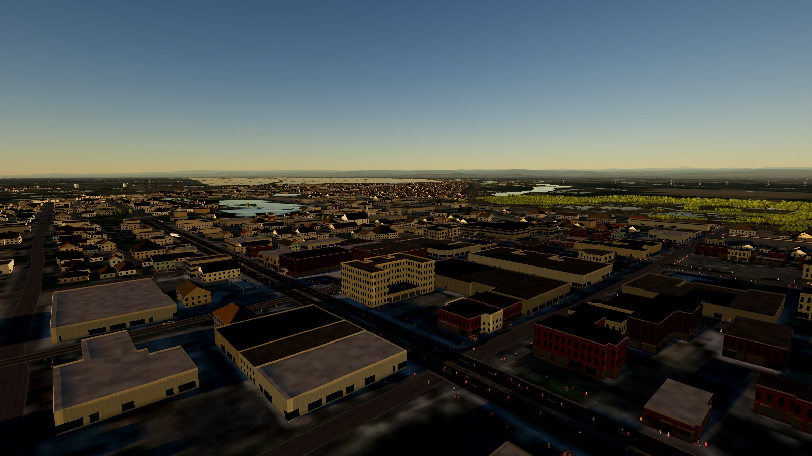

## What's there

**Every building.** The town covers a 5.2 km square centred on downtown, taking in the old town, the east side of Yuba City and both river crossings. Each of its roughly 5,500 OpenStreetMap buildings is extruded from its own footprint. About a hundred buildings have heights or storeys tagged by mappers, and those are used as given. Everywhere else, height, storeys, roof shape and material are estimated from the building type, footprint size and whether it stands in the Gold Rush blocks:

| Type | Treatment |
| --- | --- |
| Downtown commercial | Brick fronts with mortar courses, lit shopfronts between brick piers, signboards (some with neon), segmental-arched sash windows and a corbelled cornice. Awnings on the street side. |
| Stores, offices | Glass band at street level, plain panels above |
| Houses | One storey on raised floors (two for some old-town Victorians), gable or hip roofs in shingle, tile or metal, stucco or lap siding |
| Apartments, hotels | Punched windows on a storey grid, lit rooms at night |
| Industrial, sheds | Metal and concrete, low pitched roofs |
| Canopies | Fuel-station and loading canopies on posts |

**Landmarks** are built by hand on their real footprints:

- **St. Joseph Church** (cornerstone 1855). A white nave with 5 m lancet bays and buttresses under a steep gable, and a front tower facing C Street. The tower carries a louvred belfry and an octagonal spire to 30.5 m (100 ft) with a gold cross, above a rose window and a pointed door. The stained glass glows at night and the spire is floodlit.
- **Bok Kai Temple** (1880) on the levee at the foot of D Street: white walls, a double clay-tile roof and a red-columned porch with lanterns.
- **State Theatre**, with its marquee lit by bulbs.
- **Hotel Marysville**, the Yuba County Courthouse, the Chinese American Museum and the Mary Aaron Museum, named and placed where OSM maps them.

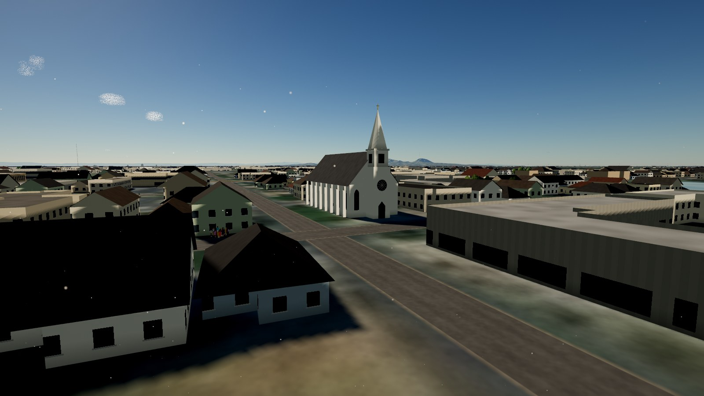

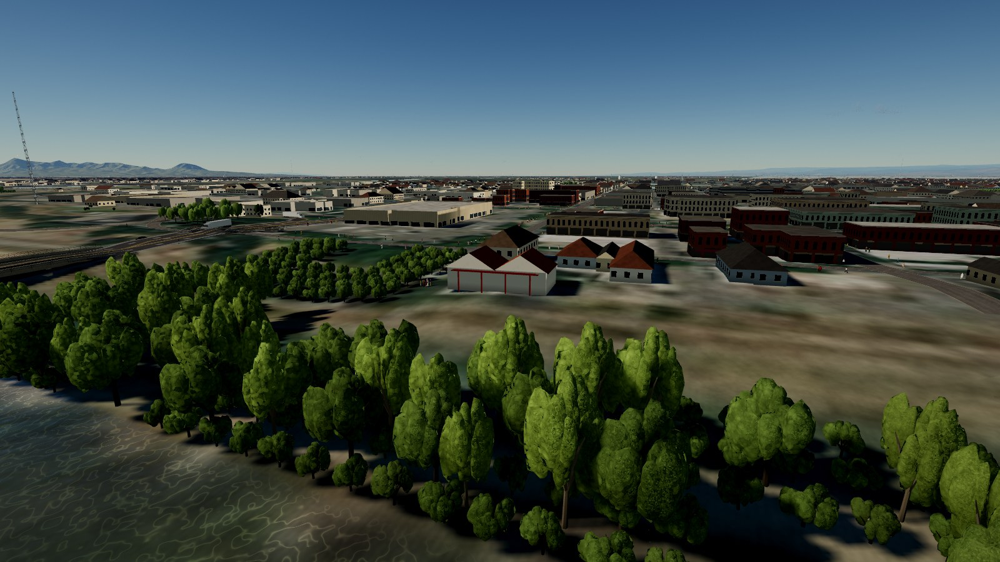

**Bridges.** On `main`, roads across the rivers were draped on the terrain, so they ran along the riverbed under the water. Now every mapped road, rail and foot bridge is built as a deck on piers:

- **Twin Cities Memorial Bridge** (Fifth Street, 2019): concrete deck on 50 m spans with three-column piers, a barrier with a metal rail, and LED lamps.
- **Northern Electric trusses** (1906–07): two 45.7 m pin-connected Pratt through-trusses over the main channel on the old interurban alignment beside it, with the approach viaduct on closely spaced piers.
- **Tenth Street / POW/MIA Bridge** (CA 20, 1947): 49 m spans with sodium lamps.
- **E Street Bridge** (CA 70) over the Yuba, plus the Union Pacific rail bridges and the smaller footbridges and boardwalks.

Each deck runs level between its abutments and lifts to clear the water (6.5 m for road and rail, 3 m for footbridges), then it is smoothed and blended into the approaches. Road bridges are registered with the terrain so that road ribbons, traffic and the truck ride on the deck rather than dropping to the riverbed. The truck no longer counts as underwater while it is on a bridge.

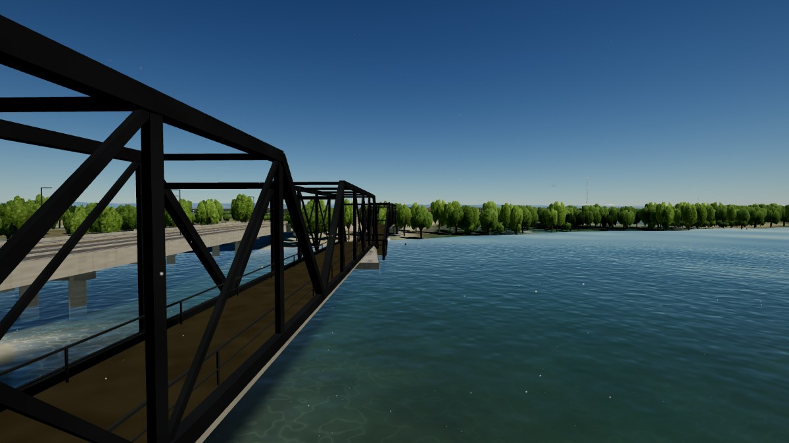

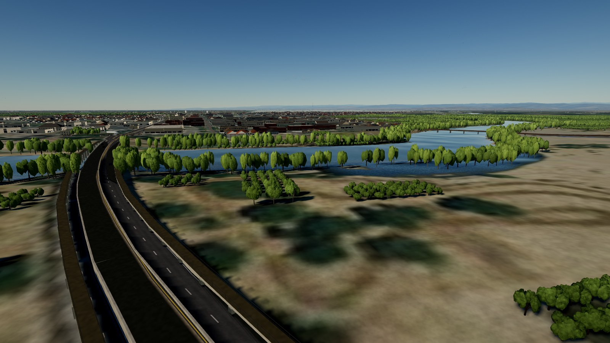

**Imagery.** A 3072 px USGS mosaic (about 1.7 m per pixel) is draped over the town, so streets, yards, parking lots and Ellis Lake read correctly from the air. It replaces the coarse mid-range imagery there, and the procedural farmland detail fades out inside town.

**Saturday night.** Downtown is busy after dark. Up to 2,800 people (900 on phones) walk the sidewalks along the building line and the mapped footpaths. Most of them are on the downtown blocks, and small groups stand outside the bars, restaurants, the theatre and the hotel. The crowd follows the clock:

| Time | Out on the street |
| --- | --- |
| 19:00 to 01:00 | Everyone |
| 01:00 to 02:30 | About two thirds |
| 02:30 to 06:00 | A few stragglers |
| Morning | A fifth, growing toward lunch |
| Midday | About half |
| 17:00 to 19:00 | The evening rush builds |

People are simple low-poly figures with a walk cycle, in a mix of skin tones, hair colours and night-out clothes: dresses, jackets, jeans. They stay off the road pavement, including divided streets and crosswalks. A soft fill light keeps them readable at night.

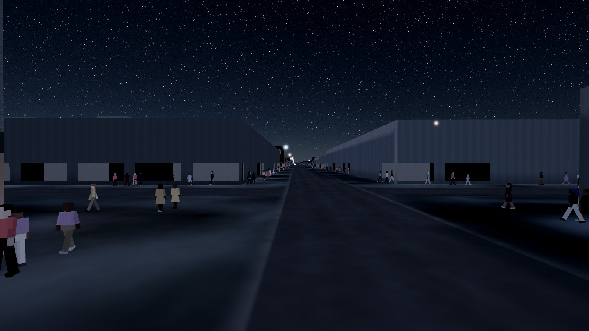

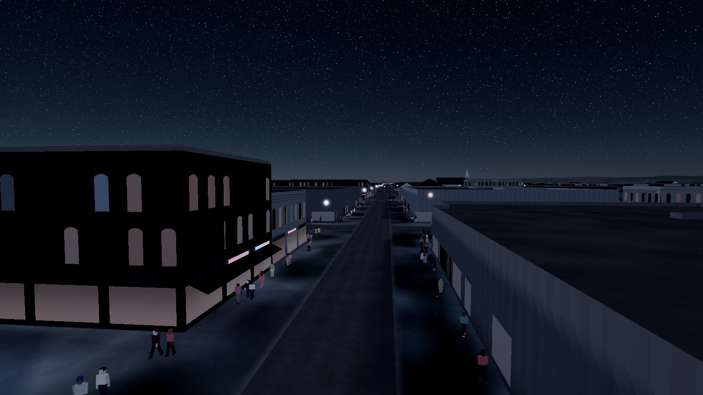

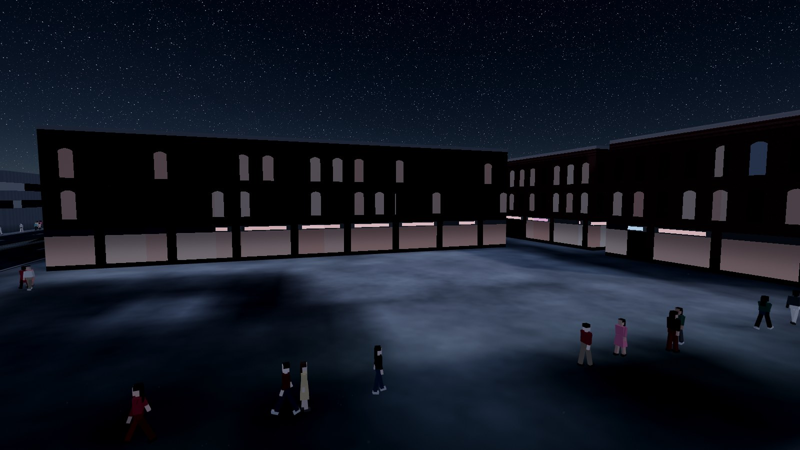

**Lore.** Five new discovery cards cover the river port, St. Joseph's, Bok Kai, the Twin Cities bridges and a secret one for D Street at night.

## Before and after

| `main` | This branch |
| --- | --- |
| 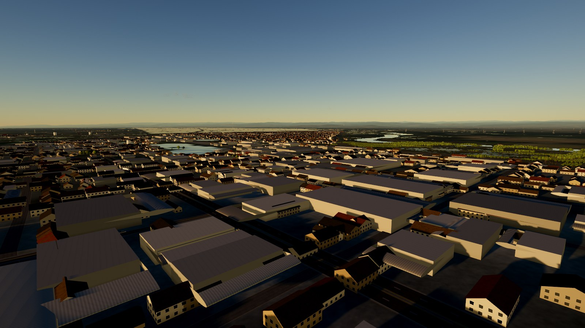 |  |
| 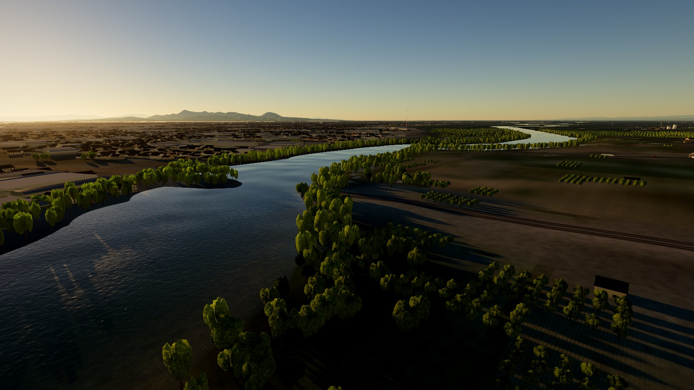 | 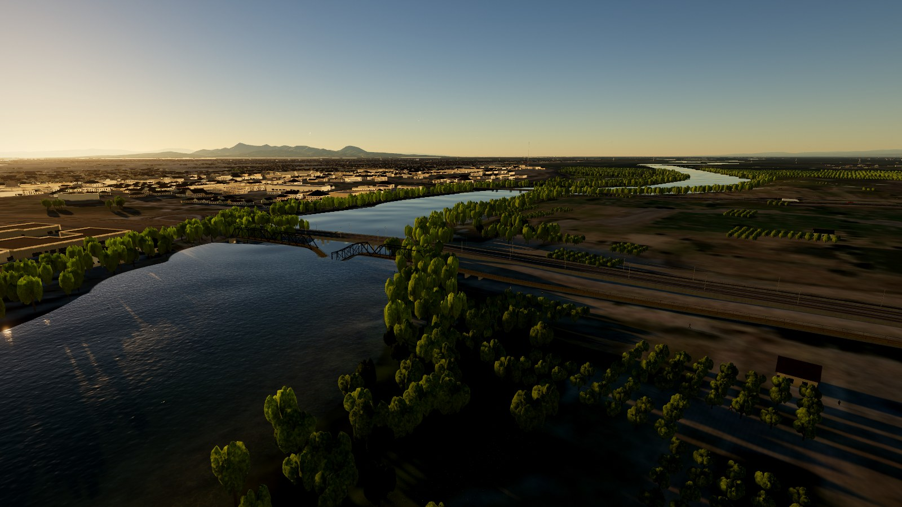 |

## Data pipeline

`npm run data` has a new `marysville` step (`scripts/lib/marysville.mjs`):

1. **Overpass query** for the town square, cached in `.cache/osm/marysville.json`. It fetches building ways and multipolygon outer rings, highway and railway bridges, `man_made=bridge` outlines (these carry names like "Twin Cities Memorial Bridge"), footways, and amenity, tourism and historic points.
2. **Classify** each building into one of eleven kinds (house, commercial, retail, apartments, civic, industrial, shed, canopy, church, temple, hotel) from its `building`, `amenity`, `shop` and `name` tags. Names from points inside a footprint are attached to that building, so the State Theatre and Hotel Marysville get their names.
3. **Massing.** Use the tagged `height` or `building:levels` where present, otherwise estimate by kind. An oriented bounding box picks gable or hip roofs for simple footprints.
4. **Landmarks** are matched by name (St. Joseph, Bok Kai, the State Theatre and so on) and flagged for the hand-built models.
5. **Bridges** are classified as road, rail, abandoned rail or foot, with widths from lanes and type.
6. **Output** goes to `public/data/marysville.json` (751 KB), and the USGS mosaic to `public/data/imagery_marysville.jpg`. `meta.json` gains a `town` entry, which is what makes the game load the town.

USGS imagery tops out at zoom 16 for this area. Zoom 17 returns 404s.

## Code

| File | Role |
| --- | --- |
| `src/world/town.ts` | Builds the buildings, landmarks and bridges. Geometry is merged into 600 m chunks that cast shadows and are hidden beyond 12 km. It also exposes landmark positions, the town zone and a building frontage ray cast. |
| `src/render/shaders/townShader.ts` | Procedural facades: brick, shopfronts, neon, sash windows, lancets, the rose window, roof materials, concrete and steel |
| `src/world/decks.ts` | Spatial index of bridge decks. `Heightfield.roadHeight()` returns the deck height when you travel along a deck. |
| `src/life/pedestrians.ts` | Instanced crowd with a GPU walk cycle, sidewalk paths and an hourly activity curve |
| `src/world/props.ts` | Generic OSM houses stand down inside the town zone. Streetlights stay. |
| `src/world/roads.ts`, `src/life/traffic.ts`, `src/vehicle/car.ts` | Use `roadHeight()` so ribbons, cars and the truck follow bridge decks |
| `src/render/shaders/terrainShader.ts` | Blends the town imagery in |
| `src/world/destinations.ts`, `places.ts`, `lore.ts` | Places menu entries, HUD place names and discovery cards |

The town is optional. Without `meta.town` (for example with data built before this step existed) the game runs exactly as before.

## Known limits

- Facades are procedural, so no building has its real signage or window pattern.
- Roof shapes are tagged for only a handful of buildings and estimated for the rest.
- The crowd doesn't react to the bird or truck, and doesn't cross streets.
- Heights are estimated for about 98% of buildings, because few are tagged in OSM. Edits on OpenStreetMap flow in on the next `npm run data`.
