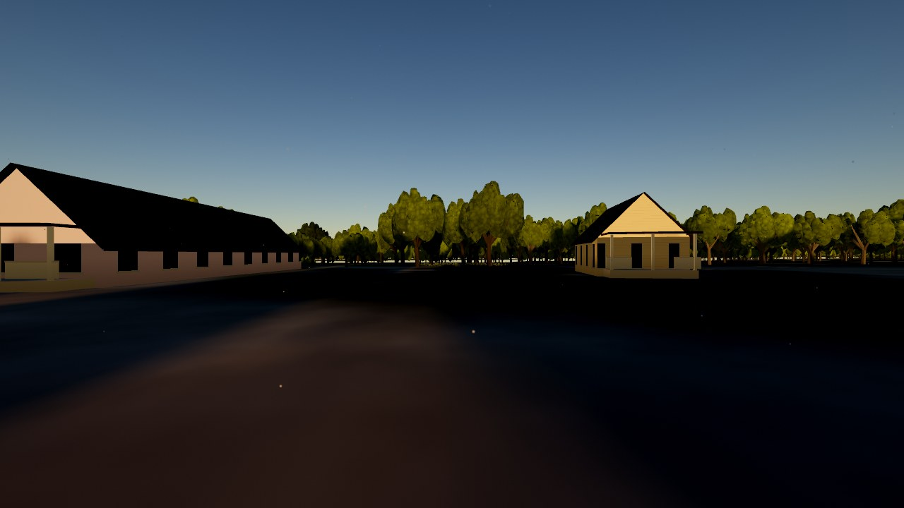
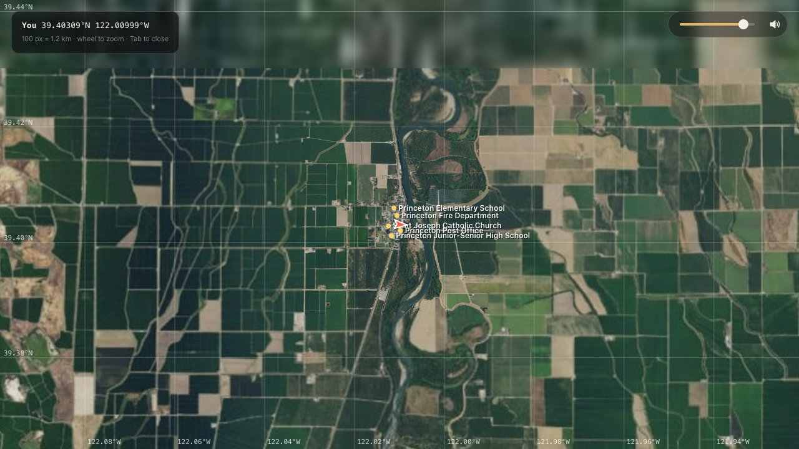
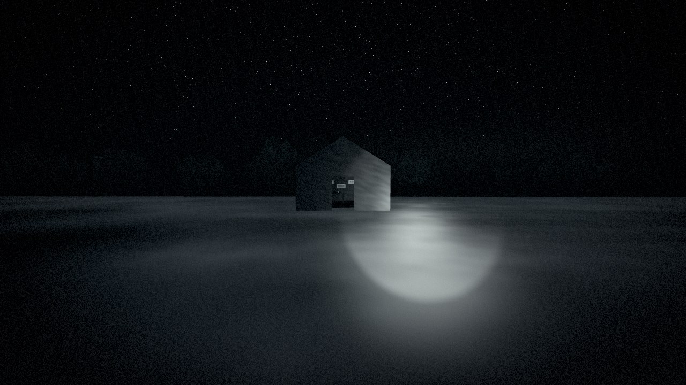
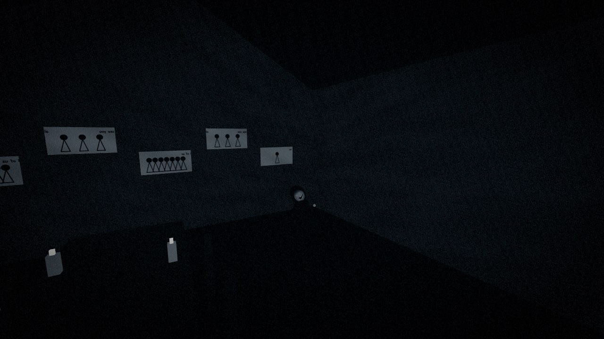
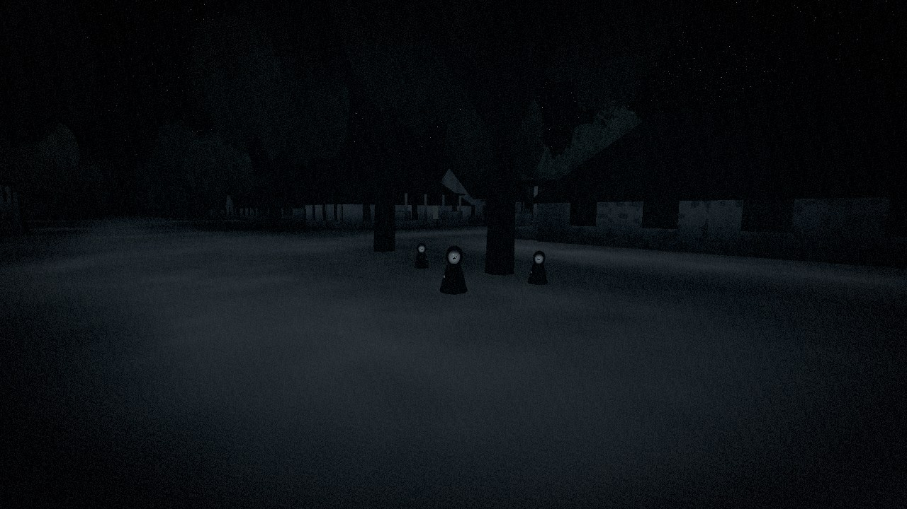

# Princeton and Nightmare Mode

Princeton is a rice town of a few hundred people on the west bank of the Sacramento River, about 20 km north-west of the Buttes in Colusa County. It is the second town built from survey data, after [Marysville](marysville.md), and the place to try free roam on foot and Nightmare Mode.

Pick **Princeton** from the menu's Places tab, or link straight to it with `?place=princeton`. Add `&walk` to arrive on foot and `&nightmare` to arrive after dark.

## Three layers

The world keeps what is real, what is estimated and what is made up apart, in code and on screen.

| Layer | What's in it | Where it lives |
| --- | --- | --- |
| Verified | Terrain, aerial imagery, roads, OSM buildings and the five landmarks below, each with a source id and a confidence score | `public/data/princeton.json`, `scripts/lib/princeton.mjs` |
| Approximated | Microsoft ML building footprints, building heights, roofs and colours, school campus layouts | Marked `s: 1` in the town data and listed under fidelity notes |
| Fictional | Everything in Nightmare Mode: hauntings, signs, the Hollow House and the figures | `src/horror/fiction.ts`, only drawn while Nightmare is on |

The hauntings are fiction. They are put on anonymous houses picked by a fixed seed (never a named building, business or landmark), are labelled "fiction" in the HUD and on the map, and vanish completely when Nightmare is switched off.

## What's there

**Buildings.** 302 buildings in a 3.6 km square. Four come from OpenStreetMap, which barely covers Princeton. The other 298 are Microsoft's machine-learned footprints (quadkey 023010030), which fill in every house, shed and dryer. ML footprints are used only where they don't overlap an OSM building, and their heights are scaled down because the ML height includes the pitched roof.

**Landmarks.** Each one is pinned to a real source and checked by `npm run verify`, which writes [landmarks-princeton.md](landmarks-princeton.md):

| Landmark | Source | Offset from source | Confidence |
| --- | --- | --- | --- |
| Saint Joseph Catholic Church | OSM way 1544678113 | 1.2 m | 0.95 |
| Princeton Fire Department | OSM way 818773987 | 3.2 m | 0.95 |
| Princeton Elementary School | OSM node 358822623 on the nearest ML footprint | 11 m | 0.8 |
| Princeton Junior-Senior High School | OSM node 358822624 on the nearest ML footprint | 16 m | 0.71 |
| Princeton Post Office | OSM node 358822625 on the nearest ML footprint | 30 m | 0.37 |

**Ground.** A 2048 px USGS orthophoto of the town is draped over the terrain, with the rice checks, ditches and levees around it from the valley-wide data.

## Free roam on foot

Press **B** to get out and walk, anywhere in the valley. Walking is 1.5 m/s and Shift runs at 4.6 m/s. You collide with walls and tree trunks, and deep water stops you. Press **Tab** for a map with real latitude and longitude, landmarks and your heading. The scroll wheel zooms it.

## Nightmare Mode

Press **N**. Your time, weather and moon are saved and swapped for a moonless night in tule fog, and the torch comes on (**F** toggles it). Press **N** again and everything is put back the way it was.

While it's on:

- the sky goes near-black, ground fog pools around you, and the image is desaturated with grain and a vignette;
- streetlights die or sputter, windows go dark or get boarded, and neon fails;
- traffic and people disappear, the wind drops, and the power lines sway anyway;
- a few houses in each town become hauntings, with an open candlelit door or a boarded one, a face that sometimes shows in a window, and a warning sign in the yard;
- the Hollow House, an invented shack on an empty lot in Princeton, can be walked into. Its resident never moves.

### The figures

Small cloaked figures, 2–3 ft tall, with pale faces, wide smiles and tiny eyes that catch the torch. A director keeps a tension score from 0 to 100 that rises with darkness, being in town, standing near a haunting, running, looking back and seeing them, and falls during cooldowns after a scare. The score drives what they do:

| Tension | State | Behaviour |
| --- | --- | --- |
| Low | Observing | They stand at a distance |
| 18+ | Following | They move only while you aren't looking at them |
| 44+ | Gathering | More of them, closer |
| 72+ | Pursuit | They chase you around walls on a flow field and spread out to cut you off |
| Caught | Surrounding | They circle you, tilt their heads and laugh. Everything goes silent for a few seconds. Break out of the ring then, or the screen goes black |

### Sound

By day the town has farm machinery and dogs on top of the valley ambience. In Nightmare the ambience fades under a low drone and a dissonant cluster, with positional giggles, laughter, whispers, footsteps, knocks, bangs and creaks, a pulse as tension builds, and sudden silence.

## Still approximate

These need real-world references to improve:

- **Post office footprint.** The OSM point is 21 m outside the nearest ML footprint, so the building may be wrong.
- **Building appearance.** Heights, roofs and colours are estimated from footprint size and type. No street-level photos have been reviewed.
- **School campuses.** Laid out from ML footprints only, with no site plan.
- **Terrain.** Outside the detailed Buttes area the elevation grid is about 49 m, so ditches and levees come from the imagery and procedural detail, not survey.
